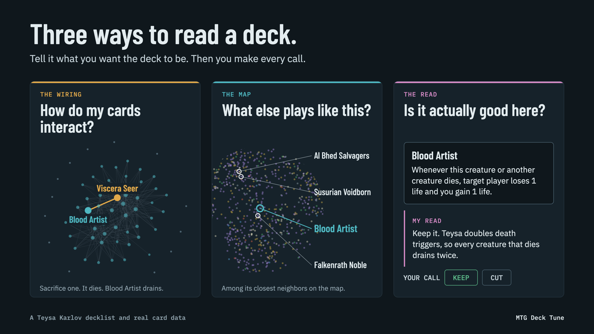
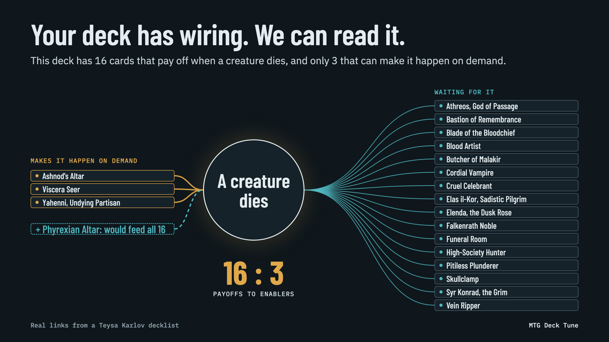
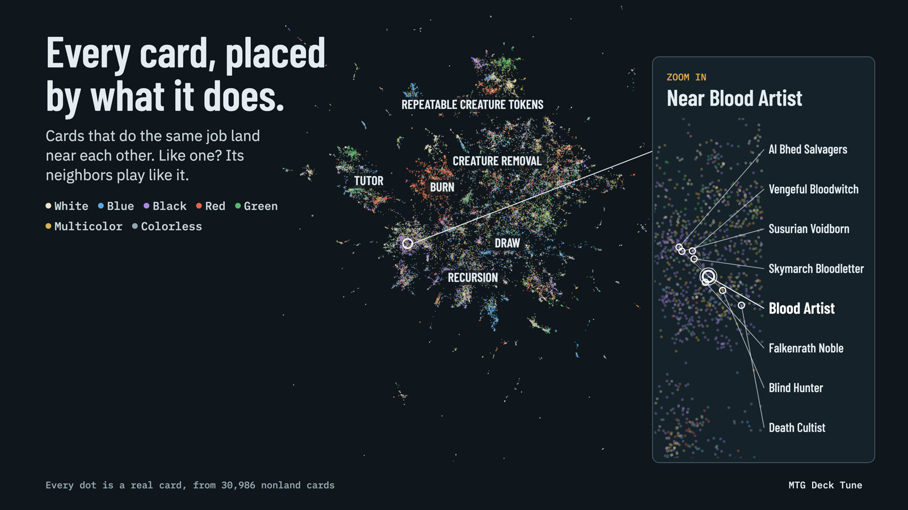

# MTG Deck Tune

Tune a Magic: The Gathering Commander deck with Claude, using card data instead of memory.



Give Claude your commander and your decklist. It tells you how that commander is usually played, asks what you want *this* deck to be, and then measures the deck against your answer. You pick what to work on, and you say yes or no to every change.

MTG Deck Tune is a free [Claude Code](https://code.claude.com) plugin. It runs on your own machine, with no account and no API key of its own.

## Install

You need [Claude Code](https://code.claude.com) and [Bun](https://bun.sh).

```bash
claude plugin install mtg-deck-tune --marketplace cgm-studios/mtg-deck-tune
```

Or, inside a Claude Code session:

```
/plugin marketplace add cgm-studios/mtg-deck-tune
/plugin install mtg-deck-tune@cgm-studios
```

Start a new session afterward. The first time the card tools run, they download the card data (about 63 MB, checked against a checksum) into the plugin's data folder. That takes a minute, once.

### Have your agent install it

Paste this into Claude Code:

```
Install the MTG Deck Tune plugin from github.com/cgm-studios/mtg-deck-tune.

1. Run `bun --version`. If Bun is missing, stop and point me to https://bun.sh.
2. Run `claude plugin marketplace add cgm-studios/mtg-deck-tune`.
3. Run `claude plugin install mtg-deck-tune@cgm-studios`.
4. Run `claude plugin list` and confirm mtg-deck-tune is listed.

Then tell me to start a new session, and that the first deck I bring will
take about a minute while the card data downloads.
```

### Notes for agents

If you are an agent reading this to set the plugin up for someone:

- The two commands in steps 2 and 3 above are the whole install. Nothing needs configuring, and there are no keys or environment variables to set.
- Bun must be on the `PATH`, because the plugin's card-data server runs on it.
- The plugin loads in sessions started after the install. It adds two skills, `deck-tune` and `deck-primer`, and one MCP server, `mtg-deck`.
- The first tool call downloads the card data and can take a minute. That is expected, so wait for it instead of retrying.
- A deck is a text file with one card per line (`1 Sol Ring`), or a list pasted into the chat. Accepting a swap rewrites a deck file, so a pasted list needs a place to be saved first.
- To update: `claude plugin update mtg-deck-tune@cgm-studios`.

## Use

Put your decklist in a text file in your project, one card per line (`1 Sol Ring`), and ask. You can also paste the list into the chat.

**Tune a deck.** Name a goal, or don't:

```
/mtg-deck-tune:deck-tune decks/my-deck.txt  I want this deck to be more mana efficient
```

```
Here's Teysa Karlov and my list in decks/teysa.txt. Help me tighten it up.
```

**Explain a deck.** A primer of the deck as it stands, with nothing changed:

```
/mtg-deck-tune:deck-primer decks/my-deck.txt
```

**See what changed.** After you accept swaps, ask for the before-and-after page.

## What you get

**The deck's numbers.** Cards and lands, average mana value, the mana curve, colored pips, and how many cards do each job (ramp, card draw, removal, protection).

**How your commander is usually played.** Its common themes and how often each shows up, next to how your list compares. This sets up the question that matters: what do you want this deck to be?

**A diagnosis against your plan.** Your answer becomes the plan, and the deck is measured against it:

- engines where the payoffs outnumber the cards that set them off
- jobs the deck has too much or too little of
- cards that serve no part of the plan
- the cards doing the least, each with the reason



**A shortlist for the problem you pick.** About 30 cards in your commander's colors, each labeled by where it came from: *fits this commander*, *deeper cut*, *widely played* or *engine partner*. Each one shows how it connects to cards already in your deck.



**Swaps you can judge.** Claude reads the shortlist and brings you only the changes it would stand behind. Each one comes with:

- **Reason (data):** the job the two cards share and the mana value change
- **Deck after:** average mana value, curve and role counts before and after, with a warning when a swap leaves a job thin
- **My read:** Claude's own opinion on whether the card is good here, labeled so you can tell it from the data

**A deck file that keeps its history.** Accepted swaps rewrite your deck file and add a dated line at the bottom saying what changed.

**A before-and-after page.** One self-contained HTML file saved beside your deck: the numbers and curve before and after, and a map of the triggers that drive your plan, showing which cards cause each one and which pay it off.

**A primer.** About a page: overview and strategy, key synergies, cool plays, ways to win, what can go wrong. Every line names its cards and says what each one's text contributes, so you can check it against the cards.

## The tools

The plugin gives Claude twelve card-data tools. You never call them yourself, but this is what Claude is working with.

| Tool | What it does |
| --- | --- |
| `deck_stats` | The deck's numbers: average mana value, curve, role counts, pips, and any lines it could not read |
| `commander_profile` | How a commander is usually played, and how your list matches that |
| `diagnose` | What the deck lacks and overdoes against your plan |
| `shortlist` | About 30 cards to add for one diagnosed problem |
| `swap_candidates` | One-for-one replacements that are cheaper to cast or cheaper to buy |
| `find_cards` | Search by type, keyword, mana symbols, rules text, price or what a card does |
| `tags` | Looks up the labels `find_cards` uses for a concept ("sacrifice outlet", "anthem") |
| `card` | One card in full, or several at once |
| `neighbors` | Cards that play like a given card |
| `accept_swap` | Records your yes and rewrites the deck file |
| `reject_swap` | Records your no; the deck file stays as it is |
| `deck_compare` | Lists the deck's triggers, then saves the before-and-after page |

## How it thinks

**You steer.** You make three calls: the plan, the problem to work on, and each swap. Claude never changes your deck until you accept a swap, and a pick or a "looks interesting" is not a yes.

**Your deck, not the average one.** The plan comes from you, never from the commander's text. If most people play your commander one way and you want another, the tools measure against yours. Popularity is one signal among four, and at most 5 cards on a shortlist are there only because they are widely played.

**Data for facts, judgment for taste, and a label between them.** Costs, rules text and every count come from the card data in that session, not from memory. The data can narrow about 31,000 cards to a shortlist with reasons, but it cannot tell a strong card from a weak one. That part is Claude's judgment, and it is always marked **My read**.

**Only cards the tools found.** Every card Claude suggests came back from a tool in that session. No half-remembered cards, and no cards that don't exist.

**The same question gets the same answer.** The tools hold no opinions. The same deck and the same plan return the same result, card for card.

**It talks Magic.** Replies read the way a player would say it: "a card that does the same job for 3 less mana".

## What it does not do

- It tunes a deck you already have. It does not build one from nothing.
- It is for Commander only.
- The wiring between cards does not yet read static effects (anthems, lords), trigger doublers or keywords that cause events. Where the tools cannot read a card, they say so instead of calling it a cut.
- A primer reads the cards' rules text, not official rulings, so confirm the interactions before you rely on them.

## Updates

Run `claude plugin update mtg-deck-tune@cgm-studios`, or turn on auto-update for the `cgm-studios` marketplace under **Marketplaces** in `/plugin`.

## Data

Card data comes from [Scryfall](https://scryfall.com) and Scryfall Tagger, used under the Wizards of the Coast Fan Content Policy. MTG Deck Tune is free and not affiliated with or endorsed by Scryfall or Wizards of the Coast.

Portions of the materials used are property of Wizards of the Coast. ©Wizards of the Coast LLC.

## License

GPL-3.0. See [LICENSE](LICENSE).
